# 03 — Esquema do Banco de Dados

- **SGBD:** MySQL 5.7.44 (produção) / MariaDB 10.3+ compatível
- **Base:** `controle` — `utf8mb4` / `utf8mb4_unicode_ci` — engine InnoDB
- **Script de criação:** [`database.sql`](../database.sql)
- **Migrações incrementais:** [`migrations/`](../migrations/) (001 a 004)

## 1. Diagrama Entidade-Relacionamento (DER)

```mermaid
erDiagram
    peps ||--o{ ms_contas : "pep_id"
    peps ||--o{ telefonia_contas : "pep_id"
    peps ||--o{ dispositivos : "pep_id (SET NULL)"
    ms_contas ||--o{ ms_contas_licencas : "conta_id"
    ms_licencas ||--o{ ms_contas_licencas : "licenca_id"
    tipos_dispositivos ||--o{ dispositivos : "tipo_id"

    peps {
        int id PK
        varchar pep UK
        varchar projeto
        varchar centro_custo
        int periodo_meses
        date data_inicio
        date data_termino
        varchar responsavel_nome
        varchar responsavel_cpf
    }
    usuarios {
        int id PK
        varchar usuario UK
        varchar nome
        varchar email
        varchar senha
        enum perfil "admin|usuario"
        enum origem "local|ldap"
        timestamp criado_em
    }
    ms_licencas {
        int id PK
        varchar codigo_licenca
        varchar descricao
        decimal valor
        varchar modo_cobranca
    }
    ms_contas {
        int id PK
        varchar nome
        varchar email
        int pep_id FK
    }
    ms_contas_licencas {
        int id PK
        int conta_id FK
        int licenca_id FK
    }
    ms_cobrancas {
        int id PK
        int mes
        int ano
        decimal valor_total
    }
    telefonia_contas {
        int id PK
        varchar nome_usuario
        varchar telefone
        varchar operadora
        int pep_id FK
        decimal valor
        varchar conta_telefonia
    }
    telefonia_cobrancas {
        int id PK
        int mes
        int ano
        decimal valor_total
        varchar conta_telefonia
    }
    rateios_historico {
        int id PK
        enum tipo "microsoft|telefonia"
        int mes
        int ano
        varchar gerado_por
        timestamp gerado_em
        decimal valor_boleto
        decimal total_contas
        decimal diferenca
        decimal total_final
        longtext dados_json
    }
    tipos_dispositivos {
        int id PK
        varchar nome UK
        varchar icone
        varchar descricao
    }
    dispositivos {
        int id PK
        int tipo_id FK
        int pep_id FK
        varchar nome
        varchar numero_serie
        varchar imei UK
        varchar modelo
        varchar fabricante
        enum status
        enum origem "manual|glpi"
        int id_glpi
        json dados_glpi
    }
    sincronizacoes_glpi {
        int id PK
        enum tipo_sincro
        datetime data_inicio
        enum status
        int total_items
        json detalhes_json
    }
    config_ldap {
        tinyint id PK
        tinyint habilitado
        varchar host
        varchar base_dn
        varchar grupo_admin
        varchar grupo_usuario
    }
    config_smtp {
        tinyint id PK
        enum metodo "smtp|oauth"
        varchar host
        enum oauth_provedor
    }
    config_glpi {
        tinyint id PK
        tinyint habilitado
        varchar url_base
        varchar app_token
        varchar user_token
    }
    contatos {
        int id PK
        varchar nome
        varchar email
        tinyint lista_microsoft
        tinyint lista_telefonia
    }
```

> `config_ldap`, `config_smtp` e `config_glpi` são tabelas de **linha única**
> (`id = 1`); `usuarios`, `contatos` e `sincronizacoes_glpi` não têm FK e por
> isso aparecem soltas no diagrama.

## 2. Tabelas (resumo)

| Tabela | Finalidade | Linhas (prod.) |
|--------|------------|:--------------:|
| `usuarios` | Contas de acesso (local e LDAP) | 3 |
| `config_ldap` | Parâmetros de autenticação AD (linha única) | 1 |
| `config_smtp` | Parâmetros de envio de e-mail (linha única) | 0 |
| `config_glpi` | Parâmetros da integração GLPI (linha única) | 1 |
| `contatos` | Listas de e-mail por gerência | 0 |
| `peps` | PEPs/Projetos (cadastro central) | 54 |
| `ms_licencas` | Catálogo de licenças Microsoft | 5 |
| `ms_contas` | Usuários/contas Microsoft | 179 |
| `ms_contas_licencas` | Vínculo N:N conta↔licença | 188 |
| `ms_cobrancas` | Cobrança (boleto) mensal Microsoft | 8 |
| `telefonia_contas` | Linhas telefônicas | 117 |
| `telefonia_cobrancas` | Cobrança mensal Telefonia | 12 |
| `rateios_historico` | Histórico de rateios gerados (JSON) | 4 |
| `tipos_dispositivos` | Tipos de dispositivo | 12 |
| `dispositivos` | Inventário (manual + GLPI) | 289 |
| `sincronizacoes_glpi` | Log das sincronizações GLPI | 0 |

*(contagens aproximadas de `information_schema` em 2026-10-08)*

## 3. Relacionamentos e integridade

- `ms_contas.pep_id` e `telefonia_contas.pep_id` → `peps.id` (RESTRICT).
- `dispositivos.pep_id` → `peps.id` **ON DELETE SET NULL**.
- `dispositivos.tipo_id` → `tipos_dispositivos.id`.
- `ms_contas_licencas` → `ms_contas` e `ms_licencas` **ON DELETE CASCADE**.
- Chaves únicas relevantes: `usuarios.usuario`, `peps.pep`,
  `dispositivos.imei`, e `(id_glpi, origem)` em `dispositivos` (evita importar
  o mesmo item do GLPI duas vezes).
- Índices de performance em `dispositivos`: `tipo_id`, `pep_id`, `origem`,
  `status`, `id_glpi`.

## 4. Migrações

Instalações novas usam apenas `database.sql`. Bancos já existentes aplicam, em
ordem, os arquivos em [`migrations/`](../migrations/):

| Arquivo | O que adiciona |
|---------|----------------|
| `001_add_contract_fields_to_peps.sql` | Campos de contrato em `peps` |
| `002_add_dispositivos_module.sql` | Módulo de dispositivos + GLPI |
| `003_glpi_ssl_e_tipos.sql` | Verificação SSL e tipos de dispositivo |
| `004_add_imei_dispositivos.sql` | Campo/único de IMEI |

O rodapé de `database.sql` traz ainda blocos comentados de migração legada
(renomeação `vivo_*` → `telefonia_*`, remoção de planos etc.), a serem
executados manualmente **somente** se o banco estiver em formato antigo.
